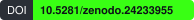
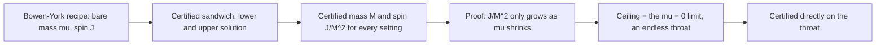

# How fast can a Bowen-York black hole spin?

**A widely used recipe for spinning black holes on a computer has a spin ceiling. We proved, with a computer that
carries a guaranteed error bar, that its J/M² always stays below 0.9282004588 and, for a small enough bare mass,
rises above 0.9282004587.**

[](https://doi.org/10.5281/zenodo.24233955)  [](https://github.com/Hashirama1337s)

Moki & Julio · 2026 · version 1.0

**Read** [paper.md](paper.md) · **Re-run** [code/RUN.md](code/RUN.md) · **Check** [CLAIMS.md](CLAIMS.md) and [SCORECARD.md](SCORECARD.md)

**The magic trick.** The fastest-spinning member of this family does not exist: every member can be beaten. Yet the
ceiling is a real object, an endless throat, and one certified function drawn on that throat pins its spin from both
sides to ten digits.

## In plain words

A spinning black hole has a mass M and an angular momentum J. Einstein's theory allows J/M² up to 1 for a black hole
that has settled down. Computer simulations need a starting snapshot of the black hole, and a common recipe for a
spinning one, due to Bowen and York, cannot reach 1. Numerical work since 1990 pointed to a ceiling near 0.928 (first
printed in 2002), and a 2008 study gave 0.928200.

We certified the ceiling. For every setting up to j ≈ 12,000 we trapped the mass between guaranteed bounds, and beyond
that we bounded the spin from above, so every bound is a proof, not an estimate. The spin ratio grows as one parameter, the "bare mass", shrinks,
but no setting reaches the top. In the limit the black hole becomes an infinitely long throat. We measured that limit
directly: J/M² lies between 0.92820045875619 and 0.92820045878266.

Along the way we proved four facts by hand. The mass is a convex curve with no kinks in the bare mass. The mass of the
limiting throat is fixed by one curve on a sphere. For any finite bare mass the black hole's surface sits exactly at
the throat, with no other candidate. The limiting throat has no horizon at all, a question Dain and Gabach Clement left
open in 2008 (numerics already pointed that way).

**The idea in one picture.** A ladder whose rungs climb toward a ceiling. We weigh every rung with a certified scale,
prove that the rungs only go up, and then measure the ceiling itself. **Where the picture breaks.** The ceiling is not
a top rung. It is a different object, the infinite throat, and it needs its own certificate.

## At a glance

- **Claim (computer-assisted).** For the single, non-boosted, conformally flat, maximal Bowen-York spinning puncture
  (puncture boundary conditions, J = J_ADM, bare mass μ > 0): sup J/M_ADM² is in [0.9282004538, 0.9282004687], so it
  rounds to 0.928200; it is not attained, and it equals the spin of the extreme (μ = 0) data, certified in
  [0.92820045875619, 0.92820045878266].
- **Theorems.** At fixed J ≠ 0 the mass M(μ) is strictly increasing with slopes in (0, 1), strictly convex and C^1. The
  extreme data's mass is M_0 = (1/(6π)) ∫ (4|∇V|² + V²) dΩ = (2/3) Σ (2l+1) a_l² from the throat profile V. For μ > 0
  the throat is the only closed connected MOTS and minimal surface. The extreme data contain no closed minimal surface, MOTS or
  apparent horizon (two independent proofs).
- **Not new.** Monotonicity, slopes in [0, 1] and continuity at μ = 0 are corollaries of Dain and Gabach Clement's
  lemmas (we record them). The flux behind the mass formula is the radial Pohozaev invariant of Korevaar, Mazzeo, Pacard
  and Schoen. The sliding method is Berestycki and Nirenberg's. A ≥ 8π|J| is Dain and Reiris's. The values 0.928 and
  0.928200 are in print as numerical results.
- **Checked.** Every certificate run was a sealed test (16 HOLD, 1 FAILED); the probe values are unsealed and labelled.
  Masses, the supremum decision and the extreme spin were each reproduced by blind seats with independent code.
  Fifteen internal hostile referee reports (not external peer review), plus one on this release text. A clean-room
  reproduction from the repository alone (re-running the P2c ceiling assembly, B2V, B3T, FLUXT and the full P2e
  certificate; the other stages ship their recorded outputs) ended with "ALL CHECKS PASS". Lean checks one cell inequality.
- **Conditions.** Ball arithmetic (arb) is trusted. Existence of the solution for μ > 0 is cited. A few standard
  analysis facts are used without opening a textbook; the maximum principles are proved in the paper.

## What we do not claim

- No certified area-spin constant. The probe value A_0/(8πJ) ≈ 1.1991 is not certified; A ≥ 8π|J| is Dain and Reiris's
  theorem for the μ > 0 throats (it does not directly cover the μ = 0 data), and the probe constant is not proved sharp.
- No certified digits from the mass formula beyond the windows above; its long digit strings are probe values.
- No proof of the throat exponent (Conjecture E); a sealed numerical test agrees with it.
- One blind tangent certificate (REP6) FAILED as sealed; its tightened rerun (REP6b) held, with a thin margin.
- Nothing about boosted data, binaries, Kerr, or the evolution (event horizons).
- The final text has had one internal referee round only, and the novelty searches (to 2026-11-14) must be re-run before
  release.

## How it works

### Step 1 - the idea (for anyone)



The true black-hole snapshot solves one equation, the Hamiltonian constraint. We cannot write its solution down, so
we trap it. We build two explicit functions, one provably below the solution and one provably above. Their tails at
large distance give a lower and an upper bound on the mass.

### Step 2 - how it works (for a curious student)

Everything depends only on one number, j = 4J/μ². The computer builds a polynomial approximation, works out its error
exactly in rational arithmetic, and shifts it up and down by more than that error. A comparison lemma then guarantees
that the true solution sits in between.

A worked example from the repository: at j = 10 the certified mass excess δ = M/μ − 1 lies in
[0.738555349918561234, 0.738555349918583462], so J/M² lies in [0.82710941638178, 0.82710941638181]. A blind seat that
never saw this code put δ(10) inside that interval, 21 digits deep.

To reach the ceiling, a "tangent lemma" turns one certified point into a straight line that the mass can never fall
below. Twenty-two points at j = 1, 2, 4, ..., 2^21 then bound the spin for every j at once.

### Step 3 - the real thing (for specialists)

The paper states nine results with their exact hypotheses (results 1-9 in [paper.md](paper.md), Section 1). The proof
appendix writes out the derivative decay at μ = 0, the C^1 convergence at the throat, a self-contained strong maximum
principle, and a repair of one step in a published proof. [CLAIMS.md](CLAIMS.md) lists every claim with its status and
every number with its source file.

## Use it as a tool

- **Questions it answers.** What is the mass of a Bowen-York spinning puncture at a given spin, with a guarantee? How
  close to the ceiling is a given setting? Does a candidate surface in these data form a horizon?
- **Reproduce.** Instructions are in [code/RUN.md](code/RUN.md). The certificate runs, their result files and the
  sealed verdicts are in `code/` and `results/`.
- **Reuse.** The engine in `code/gravity_engine/` certifies sub/super-solution pairs for axisymmetric Lichnerowicz
  equations; the tangent certificate gives one-sided global mass bounds from one node. The throat formula turns the
  extreme mass into a one-dimensional problem.

## Words you will meet

- **Bowen-York data**: a standard formula for a spinning black hole's snapshot, used to start simulations.
- **Puncture**: the point r = 0 of the snapshot, which stands for a second, mirror-image region of space (for μ > 0).
- **Bare mass μ**: the recipe's mass parameter; the physical mass M is larger.
- **ADM mass**: the total mass, read off far away from the black hole.
- **Sub/super-solution**: two explicit functions proved to lie below and above the true solution.
- **Ball arithmetic**: every number is stored with a guaranteed error radius, so results are bounds.
- **MOTS / apparent horizon**: a closed surface from which outgoing light just fails to escape; the usual marker of a
  black hole's surface in a snapshot.
- **Sealed test**: a prediction and its pass bar, hashed before the run and scored as written.
- **Seat**: a separate internal working session of the lab with its own files. Referee seats and blind seats are
  internal checks, not external peer review; a blind seat did not see our code or the values it was asked to reproduce; partial context is disclosed per test in the paper (Section 9).
- **Lean**: an interactive proof assistant whose kernel checks every step of a formal proof.

## How to cite

```
Moki & Julio (2026). Certified spin, mass and horizons of the Bowen-York spinning puncture family. Version 1.0. Zenodo. https://doi.org/10.5281/zenodo.24233955
```

The DOI always resolves to the newest archived version. Version 1.0 is 10.5281/zenodo.24233956. Machine-readable: [CITATION.cff](CITATION.cff). Text and data: CC BY 4.0 (`LICENSE`). Code: MIT (`LICENSE-CODE`).

## Related projects

- [certified-kummer-k3](https://github.com/Hashirama1337s/certified-kummer-k3): a certified closeness bound for a Kummer K3 surface
- [certified-chen-lebrun-weber](https://github.com/Hashirama1337s/certified-chen-lebrun-weber): a certified approximation of the Chen-LeBrun-Weber Einstein metric
- All projects: [the Moki & Julio lab map](https://github.com/Hashirama1337s)

---

*Prepared with AI assistance; what was checked, and by what, is stated above.*
